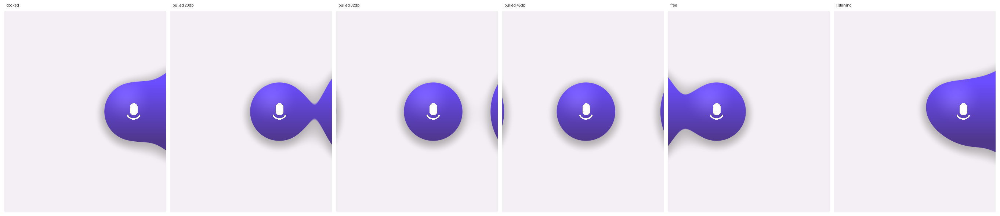

# Voiability

Talk, and it types. A Wispr Flow–style dictation app for Android where **everything runs on your phone**: speech recognition (Whisper) and AI polish (a small LLM) both run on the CPU. There are no accounts and no cloud. The internet is only used to download the models you pick.



## Features

- **Floating bubble.** It sits next to whatever keyboard you use. There are two looks: **Flat** is a solid Material You disc, and **Liquid** is a metaball shader that melts into the side of the screen and stretches a neck as you pull it away. You can pick its colour (primary, secondary, tertiary, neutral or inverse wallpaper tones), size and resting opacity. You can also choose the listening animation (waveform, pulse ring or blobs) and the working animation (arc, morphing Material 3 shape, orbiting dots or ripple). It reacts to your voice with auto-gain. Drag it onto the ✕ to hide it until the next time a keyboard opens.
- **Quick Settings tile** to show or hide the bubble.
- **Voice keyboard.** A mic-first keyboard with style chips, backspace, undo and a key to switch back to your normal keyboard.
- **Styles.** Built-in styles are Clean, Casual, Professional, Email, Notes, Hype and Raw. You can edit or delete any of them (and restore them later), or write your own, e.g. *"make it really casual no capitals"*, and test it on-device before saving. Emoji in style labels can be turned off. Hard rules (all lowercase, no final period) are always enforced, even if the AI forgets. Styles can also be set per app (WhatsApp → Casual, Gmail → Email, …), or you can switch per-app styles off entirely.
- **Smart cleanup.** Filler words are removed and self-corrections are applied ("at 5, no wait, 6" becomes "at 6"). You can say "new line" and "scratch that". There's also a personal dictionary for names and jargon.
- **Fast.**
  - Live preview while you speak.
  - Silero VAD skips silence (and stops Whisper's "thank you." hallucinations).
  - The LLM keeps the system prompt in its KV cache, so it only processes your new words.
  - Models load in the background as soon as a keyboard opens.

## Install

1. Download `Voiability-v1.apk` from the **v1** release, or build it yourself:
   ```bash
   git clone --recursive <this repo>
   ./gradlew :app:assembleRelease   # needs the Android SDK and NDK 27.2.12479018
   adb install app/build/outputs/apk/release/app-release.apk
   ```
2. Open Voiability and follow the 4-step setup. It recommends models for your RAM; on a Snapdragon 8 Elite that's Whisper Small + Qwen 2.5 1.5B, about 1.3 GB.
3. Turn on the **bubble** (Accessibility) and/or the **keyboard** (Settings → Keyboards).

You need an ARMv8.2+ phone with int8 matmul (Snapdragon 8 Gen 1 / Tensor G2 / Dimensity 9000 or newer) running Android 10+. The liquid shader needs Android 13+; older versions get a flat bubble.

## How it works

```
mic (16 kHz) → Whisper (+VAD, live previews) → rule cleanup → LLM polish (style prompt) → style rules → text field
```

| Path | What |
|---|---|
| `engine/` | JNI bridge for whisper.cpp + llama.cpp (one shared ggml, static, `-march=armv8.2-a+dotprod+fp16+i8mm`) |
| `app/.../dictation/` | Pipeline, prompt builder (`Polisher`), rule cleaner, engine lifecycle |
| `app/.../overlay/` | Bubble window + spring physics, AGSL metaball renderer, accessibility service |
| `app/.../ime/` | The voice keyboard |
| `app/.../ui/` | Material 3 Expressive app: onboarding, home, styles, models, settings |

### Releases

`.github/workflows/release.yml` runs on every push. It runs the unit tests, builds the release APK, moves the `v1` tag to the pushed commit and replaces the APK on the **v1** GitHub release. To sign with your own key, so updates install over each other, add these repository secrets: `VOI_KEYSTORE_BASE64` (`base64 -w0 release.jks`), `VOI_KEYSTORE_PASSWORD`, `VOI_KEY_ALIAS` and `VOI_KEY_PASSWORD`. Without them the APK uses a throwaway debug key.

### Testing

`./gradlew :app:testDebugUnitTest` runs the cleanup and prompt unit tests.

`HostPipelineTest` runs the real engine on a desktop build of `libvoiengine` with real models. Set `VOI_HOST_LIB`, `VOI_MODELS` and `VOI_WAV` to run it; the test file explains what it expects.
